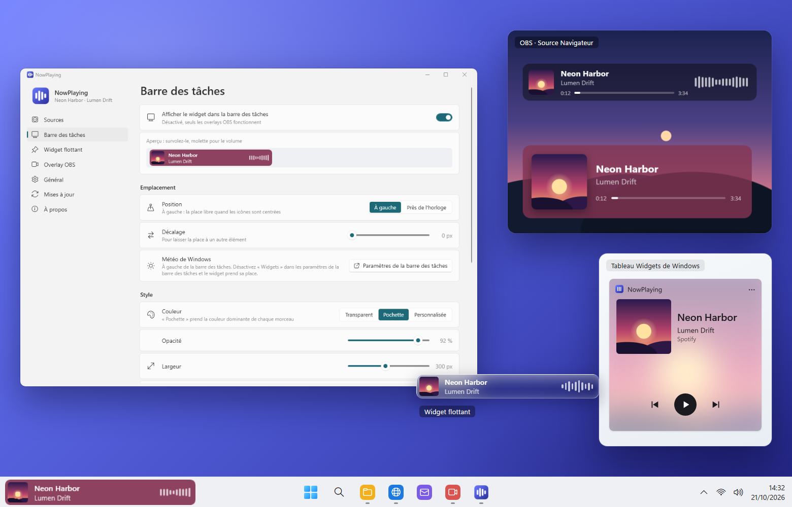

<p align="center">
  
</p>

<h1 align="center">NowPlaying</h1>

<p align="center">
  Ce qui est en lecture, directement dans la barre des tâches de Windows 11, quelle que soit l'application (Spotify,
  YouTube, Deezer…) : aussi en widget flottant, dans le tableau Widgets, et en overlay pour OBS Studio.
</p>

<p align="center">
  <a href="README.md">English</a> · <b>Français</b>
</p>

<p align="center">
  
</p>

---

> **Début du développement.** La version 0.2 ajoute un widget flottant et un widget pour le tableau Widgets de
> Windows. Aimer un morceau (Spotify) et les barres des tâches des autres écrans viendront ensuite.

## Fonctionnalités

### Dans la barre des tâches

- La **pochette, le titre et l'artiste** de ce qui joue, depuis toute application qui l'indique à Windows : Spotify,
  un navigateur (YouTube, Deezer, SoundCloud…), Lecteur multimédia, Apple Music…
- **Au survol** : précédent, lecture / pause, suivant, et la barre de progression (un clic pour avancer ; « EN DIRECT » pour un direct).
- **Molette** : le volume de l'application qui joue, pas celui de tout le PC.
- Un **visualiseur** : le vrai spectre du son, ou une animation calme.
- Le texte reste lisible : sa couleur suit ce qu'il y a vraiment derrière le widget (barre des tâches claire ou
  sombre, colorée ou transparente).
- À gauche, après la météo de Windows, ou à côté de l'horloge. Caché par-dessus les applications en plein écran,
  visible même menu Démarrer ouvert. Désactivez la météo de Windows (l'application ouvre la bonne page des
  paramètres) et le widget prend sa place.

### Plusieurs lecteurs

- Le dernier lancé s'affiche, ou le premier de **votre ordre de priorité** (un lecteur en lecture avant un lecteur en
  pause, si vous voulez).
- **Clic droit** sur un widget pour en choisir un autre, jusqu'au lancement du suivant ou jusqu'à un autre choix.
- Masquez les lecteurs que vous ne voulez jamais voir.

### Sur le bureau

- Un **widget flottant**, où vous voulez sur l'écran : glissez-le, gardez-le au-dessus des fenêtres ou dessous,
  verrouillez sa place.
- **Verre** qui accroche la lumière sur ses bords, aux couleurs de ce qu'il y a derrière, flouté autant que vous
  voulez ; transparent, la couleur de la pochette ou la vôtre ; une ombre si vous voulez.
- Son texte devient clair ou sombre selon ce qu'il y a derrière.

### Dans le tableau Widgets

- Un widget NowPlaying pour le **tableau Widgets de Windows** (Win + W) : la pochette sur un fond flouté, les
  commandes, trois tailles, clair ou sombre comme le tableau.

### Pour les streamers

- Un **overlay pour OBS Studio** : une source Navigateur qui pointe vers une page de l'application, transparente,
  mise à jour en direct.
- Deux modèles : une **barre compacte** (comme dans la barre des tâches) et une **carte**, chacun avec le temps et la
  progression si vous voulez.
- Désactivé tant que vous ne l'activez pas (**NowPlaying → Overlay OBS**).

### À votre style

- Chaque widget et chaque overlay a **son propre style** : la couleur de la pochette, verre ou votre couleur,
  largeur, coins arrondis, police, et les éléments à afficher.

### Et aussi

- L'apparence de Windows 11 (Fluent, Mica), thème clair ou sombre ; des menus comme ceux de Windows.
- **Anglais et français**.
- **Démarre avec Windows**, et ne consomme rien quand rien ne joue.
- **Mises à jour en un clic** depuis l'application (GitHub Releases).

### À venir

- [x] Widget de la barre des tâches, overlay OBS, personnalisation.
- [x] Widget flottant, widget du tableau Widgets.
- [ ] Aimer le morceau (Spotify).
- [ ] Les barres des tâches des autres écrans.

## Installation

1. Téléchargez `NowPlaying-Setup-x.y.z.exe` depuis la page [Releases](../../releases).
2. Lancez-le. L'installeur n'étant pas signé, Windows SmartScreen peut afficher « Windows a protégé votre ordinateur » :
   cliquez sur **Informations complémentaires → Exécuter quand même**.
3. Acceptez la demande d'administrateur (UAC).

L'installeur copie l'application dans `C:\Program Files\NowPlaying`, l'ajoute au menu Démarrer, et propose d'installer
le **.NET 10 Desktop Runtime** de Microsoft s'il est absent. Sur Windows 11, il ajoute aussi le widget au tableau
Widgets (**+** dans le tableau, puis NowPlaying). À son premier lancement, l'application active *Démarrer avec
Windows*.

Dans OBS : activez l'overlay dans **NowPlaying → Overlay OBS**, puis **Sources → + → Navigateur**, et collez
l'adresse donnée (par exemple
`http://localhost:6740/card`) avec la taille indiquée.

Désinstaller : **Paramètres → Applications → Applications installées → NowPlaying**.

**Configuration requise :** Windows 11 (Windows 10 2004 ou plus récent peut fonctionner), x64.

## Développement

### Prérequis

| Outil | Rôle | Installation |
|-------|------|--------------|
| **Git** | Récupérer le code | `winget install Git.Git` |
| **.NET 10 SDK** | Compiler l'application (C# / WPF) et lancer les tests | `winget install Microsoft.DotNet.SDK.10` |
| **Windows SDK** | `makeappx`, pour le paquet du tableau Widgets | `winget install Microsoft.WindowsSDK.10.0.26100` |
| **Inno Setup 6** | Construire l'installeur | `winget install JRSoftware.InnoSetup` |

### Compiler

```powershell
.\scripts\build.ps1
```

Le script lance les tests, puis écrit `dist\app\` (l'application et le widget du tableau Widgets, dépendants du
runtime, ReadyToRun), `dist\NowPlaying.Widgets.msix` et `dist\NowPlaying-Setup-<version>.exe`. Options :
`-SkipTests`, `-NoInstaller`.

### Pendant le développement

```powershell
dotnet test tests\NowPlaying.Tests        # tests unitaires
dotnet run --project src\NowPlaying       # lancer l'application (--background n'ouvre aucune fenêtre)
```

`NOWPLAYING_LANG=en|fr` et `NOWPLAYING_THEME=Light|Dark` forcent une langue ou un thème ;
`NOWPLAYING_WIDGET_STATE=hover|volume` garde le widget dans cet état (images). NowPlaying ne tourne qu'une fois par
session : quittez-le depuis son icône de notification avant de lancer une autre version.

### Organisation du code

```
src/
  NowPlaying.Core/   Logique sans interface : quel lecteur afficher, position entre deux annonces, couleur de la
                     pochette, spectre (FFT), styles du widget et des overlays, noms des applications, versions GitHub
  NowPlaying/        Application WPF : sessions média de Windows, volume par application et son du PC (NAudio),
                     le widget de la barre des tâches (dans son propre processus), le widget flottant, le serveur
                     et les pages de l'overlay (Overlay/), la fenêtre de l'application, les mises à jour
  NowPlaying.Widgets/ Le widget du tableau Widgets de Windows (lancé par Windows) et son paquet (package/)
installer/           Script Inno Setup
scripts/             build.ps1, make-icons.ps1
tests/               Tests unitaires (xUnit)
```

### Traductions

Textes de l'application : `src/NowPlaying/Properties/Strings.resx` (anglais) et `Strings.fr.resx` (français) ; les
tests vérifient que les deux ont les mêmes clés et les mêmes paramètres. Messages de l'installeur :
`installer/NowPlaying.iss`.

### Icônes

`scripts\make-icons.ps1` dessine l'icône (`.ico`, le PNG 256 px de l'application, `docs/icon-256.png`,
`docs/icons/NowPlaying.svg`). Les fichiers générés sont dans le dépôt : relancez-le seulement pour changer le dessin.

### Publier une version

1. Mettez à jour `<Version>` dans `Directory.Build.props`.
2. Commitez, puis créez et poussez un tag : `git tag v0.1.0`, puis `git push origin v0.1.0`.
3. Le workflow GitHub Actions compile, teste et publie l'installeur dans une Release.

## Confidentialité

Rien de ce que vous écoutez ne quitte votre ordinateur. Les pages de l'overlay (quand il est activé) et le widget du
tableau Widgets reçoivent ce qui joue sur `localhost` uniquement : les autres appareils de votre réseau n'y ont pas
accès. Pour le spectre, le son du PC est analysé en
mémoire pendant que les barres sont affichées, jamais enregistré ni envoyé. Le seul accès réseau est la **recherche de
mises à jour** sur GitHub (`api.github.com`), désactivable dans **Général**.

## Licence

[MIT](LICENSE.md). Utilise [NAudio](https://github.com/naudio/NAudio) (MIT) et le composant widgets du
[Windows App SDK](https://github.com/microsoft/WindowsAppSDK) (Microsoft Software License Terms, redistribuable).

## Crédits

Développé par [QuentinPerou](https://github.com/quentinperou), avec [Claude Code](https://claude.com/claude-code) (Anthropic).
