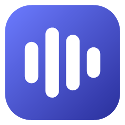
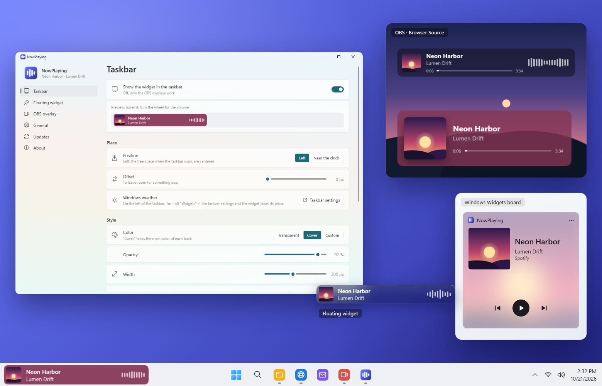

<p align="center">
  
</p>

<h1 align="center">NowPlaying</h1>

<p align="center">
  What's playing, right in the Windows 11 taskbar, from any app (Spotify, YouTube, Deezer…): also as a floating
  widget, in the Widgets board, and as an overlay for OBS Studio.
</p>

<p align="center">
  <b>English</b> · <a href="README.fr.md">Français</a>
</p>

<p align="center">
  
</p>

---

> **Early development.** Version 0.2 added a floating widget and a widget for the Windows Widgets board; 0.3 adds a
> history and the taskbars of the other screens. Liking a track (Spotify) will come next.

## Features

### In the taskbar

- The **cover, title and artist** of what's playing, from any app that tells Windows what it plays: Spotify, a
  browser (YouTube, Deezer, SoundCloud…), Media Player, Apple Music…
- **On hover**: previous, play / pause, next, and the progress bar (click to seek; “LIVE” for a live stream).
- **Mouse wheel**: the volume of the app that plays, not the volume of the whole PC.
- A **visualizer**: the real spectrum of the player's sound (not your calls nor your games), or a calm animation.
- The text stays readable: its color follows what is really behind the widget (a light or dark taskbar, a colored or
  see-through one).
- On the main screen or on every screen; a click on the cover can bring the player to the front.
- On the left, after Windows' weather, or next to the clock. Hidden over full-screen apps, visible even while Start is
  open. Turn off Windows' weather (the app opens the right settings page) and the widget takes its place.

### Several players

- The last one started is shown, or the first of **your order of priority** (one that plays before a paused one, if
  you like).
- **Right click** on a widget to pick another one, until the next one starts or until you choose again.
- Hide the players you never want to see.

### On the desktop

- A **floating widget**, anywhere on the screen: drag it, keep it above the windows or under them, lock its place.
- **Glass** catching the light on its edges, with the colors of what is behind it, as blurred as you like;
  transparent, the color of the cover or your own; a shadow if you like.
- Its text turns dark or light after what is behind it.

### In the Widgets board

- A NowPlaying widget for the **Windows Widgets board** (Win + W): the cover on a blurred background, the controls,
  three sizes, light or dark like the board.

### For streamers

- An **overlay for OBS Studio**: a Browser Source pointing to a page of the app, transparent, updated live.
- Two layouts: a **compact bar** (as in the taskbar) and a **card**, each with the time and the progress if you like.
- Always on the scene, or **a few seconds at each new track**.
- A **text file** with the track, for a Text source.
- Off until you turn it on (**NowPlaying → OBS overlay**).

### Your style

- Each widget and each overlay has **its own style**: the color of the cover, glass or your own color, width,
  rounded corners, font, and the parts you want to see.

### And also

- Windows 11 look (Fluent, Mica), light or dark theme; menus like Windows' own.
- A **history** of what played, by day, on this PC only; copy a title in one click (also from a widget's right click).
- **English and French**.
- **Starts with Windows**, and uses nothing while nothing plays.
- **Updates in one click** from the app (GitHub Releases).

### Coming next

- [x] Taskbar widget, OBS overlay, customization.
- [x] Floating widget, Widgets board widget.
- [ ] Like the track (Spotify).
- [x] The taskbars of the other screens, a history, the overlay on each new track.

## Installation

1. Download `NowPlaying-Setup-x.y.z.exe` from the [Releases](../../releases) page.
2. Run it. As the installer is not signed, Windows SmartScreen may show “Windows protected your PC”:
   click **More info → Run anyway**.
3. Accept the administrator prompt (UAC).

The installer copies the app to `C:\Program Files\NowPlaying`, adds it to the Start menu, and offers to install the
Microsoft **.NET 10 Desktop Runtime** if it is missing. On Windows 11 it also adds the widget to the Widgets board
(**+** in the board, then NowPlaying). At its first start the app turns on *Start with Windows*.

In OBS: turn on the overlay in **NowPlaying → OBS overlay**, then **Sources → + → Browser**, and paste the address
given there (for example
`http://localhost:6740/card`) with the size shown there.

To uninstall: **Settings → Apps → Installed apps → NowPlaying**.

**Requirements:** Windows 11 (Windows 10 2004 or later may work), x64.

## Development

### Prerequisites

| Tool | Purpose | Install |
|------|---------|---------|
| **Git** | Get the code | `winget install Git.Git` |
| **.NET 10 SDK** | Build the app (C# / WPF) and run the tests | `winget install Microsoft.DotNet.SDK.10` |
| **Windows SDK** | `makeappx`, to pack the package of the Widgets board | `winget install Microsoft.WindowsSDK.10.0.26100` |
| **Inno Setup 6** | Build the installer | `winget install JRSoftware.InnoSetup` |

### Build

```powershell
.\scripts\build.ps1
```

The script runs the tests, then writes `dist\app\` (the app and the widget of the Widgets board, framework-dependent,
ReadyToRun), `dist\NowPlaying.Widgets.msix` and `dist\NowPlaying-Setup-<version>.exe`. Options: `-SkipTests`,
`-NoInstaller`.

### While developing

```powershell
dotnet test tests\NowPlaying.Tests        # unit tests
dotnet run --project src\NowPlaying       # run the app (--background opens no window)
```

`NOWPLAYING_LANG=en|fr` and `NOWPLAYING_THEME=Light|Dark` force a language or a theme;
`NOWPLAYING_WIDGET_STATE=hover|volume` keeps the widget in that state (pictures). NowPlaying runs once per session:
quit it from its notification icon before starting another build.

### Code layout

```
src/
  NowPlaying.Core/   Logic without UI: which player to show, position between reports, cover color, spectrum
                     (FFT), styles of the widget and overlays, app names, GitHub releases (updates)
  NowPlaying/        WPF app: media sessions of Windows, app volume and sound of the PC (NAudio), the taskbar
                     widget (in a process of its own), the floating widget, the overlay server and pages
                     (Overlay/), the app window, updates
  NowPlaying.Widgets/ The widget of the Windows Widgets board (started by Windows) and its package (package/)
installer/           Inno Setup script
scripts/             build.ps1, make-icons.ps1
tests/               Unit tests (xUnit)
```

### Translations

App texts: `src/NowPlaying/Properties/Strings.resx` (English) and `Strings.fr.resx` (French); the tests check that
both have the same keys and placeholders. Installer messages: `installer/NowPlaying.iss`.

### Icons

`scripts\make-icons.ps1` draws the icon (`.ico`, the 256 px PNG of the app, `docs/icon-256.png`, `docs/icons/NowPlaying.svg`).
The generated files are committed: run it again only to change the design.

### Releasing a version

1. Update `<Version>` in `Directory.Build.props`.
2. Commit, then create and push a tag: `git tag v0.1.0`, then `git push origin v0.1.0`.
3. The GitHub Actions workflow builds, tests and publishes the installer in a Release.

## Privacy policy

Nothing you listen to leaves your computer. The overlay pages (when turned on) and the widget of the Widgets board get
what plays from the app on `localhost` only: other devices on your network cannot reach it. For the spectrum, the sound of the PC is analyzed in memory while the bars are shown, never
recorded nor sent. The only network access is the **update check** on GitHub (`api.github.com`), which can be turned
off in **General**.

## License

[MIT](LICENSE.md). Uses [NAudio](https://github.com/naudio/NAudio) (MIT) and the widgets component of the
[Windows App SDK](https://github.com/microsoft/WindowsAppSDK) (Microsoft Software License Terms, redistributable).

## Credits

Developed by [QuentinPerou](https://github.com/quentinperou), with [Claude Code](https://claude.com/claude-code) (Anthropic).
